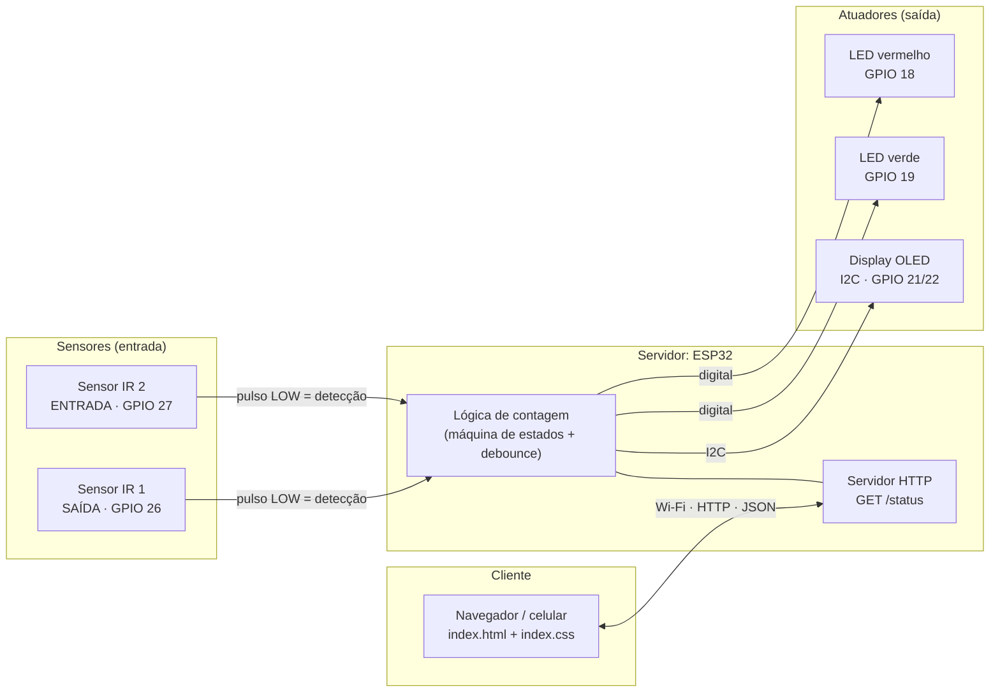
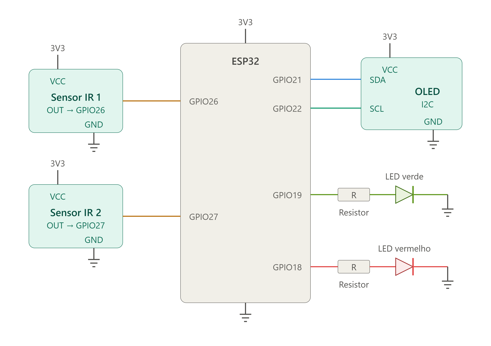
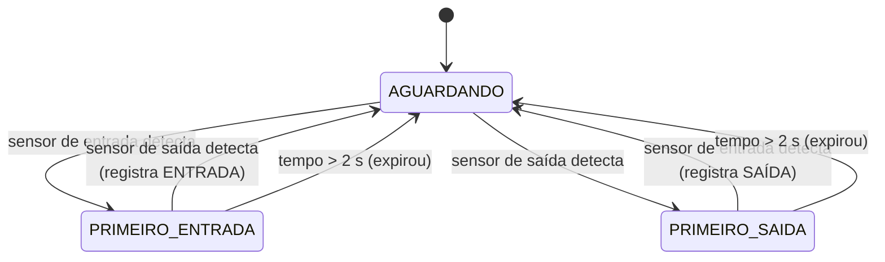

# Projeto Smart Room

Sistema de **contagem de pessoas e alerta de disponibilidade de salas**, usando um **ESP32 como servidor**. Dois sensores infravermelhos na porta identificam se alguém entrou ou saiu; o ESP32 mantém a ocupação, mostra o estado em um display OLED e em LEDs, e disponibiliza os dados para um cliente web.

> Projeto acadêmico da disciplina de **Conectividade em Sistemas Ciberfísicos** — PUCPR, Engenharia de Software.

## Sumário

1. [Problema resolvido](#1-problema-resolvido)
2. [Integrantes da equipe](#2-integrantes-da-equipe)
3. [Arquitetura da solução](#3-arquitetura-da-solução)
4. [Hardware utilizado](#4-hardware-utilizado)
5. [Como o sistema funciona](#5-como-o-sistema-funciona)
6. [Documentação da API / comunicação](#6-documentação-da-api--comunicação)
7. [Instruções de instalação e execução](#7-instruções-de-instalação-e-execução)
8. [Vídeo demonstrativo e screenshots](#8-vídeo-demonstrativo-e-screenshots)
9. [Limitações conhecidas](#9-limitações-conhecidas)
10. [Estrutura do repositório](#10-estrutura-do-repositório)

---

## 1. Problema resolvido

Em salas de estudo, laboratórios e reuniões, é comum chegar até a porta e descobrir que o ambiente está **lotado** ou que há **vagas** sem que ninguém tenha como saber antes. Sem controle de acesso, a lotação só é percebida na hora, o que gera deslocamentos desnecessários e dificulta respeitar limites de capacidade.

O **Smart Room** resolve isso com um sistema de baixo custo que:

- conta automaticamente quantas pessoas há na sala (entradas e saídas);
- sinaliza a disponibilidade **na própria porta** (LED verde/vermelho e display OLED);
- expõe a ocupação por **rede**, para que qualquer cliente consulte o estado sem estar no local.

---

## 2. Integrantes da equipe

| Nome completo | RA |
|---|---|
| Eduardo Araujo Steigleder | _preencher_ |
| Erick Kenzo Tanaka Okumoto | _preencher_ |
| Isabela Vieira Mayer | _preencher_ |
| João Victor Alves Benfica | _preencher_ |
| Rafael Siqueira Furlan | _preencher_ |

---

## 3. Arquitetura da solução

O **ESP32** é o centro do sistema: lê os sensores (entrada), controla o display e os LEDs (atuadores) e atua como **servidor HTTP** para o cliente.



### Fluxo de dados, passo a passo

1. Uma pessoa passa pela porta e aciona os dois sensores IR, um depois do outro.
2. O ESP32 aplica *debounce* e, pela **ordem** dos disparos, decide se foi entrada ou saída.
3. A ocupação é atualizada e os atuadores reagem: OLED mostra `ocupação/capacidade` e os LEDs indicam disponível/lotado.
4. O cliente faz uma requisição `GET /status` e recebe a ocupação em JSON.
5. A interface web atualiza o número de pessoas, o estado "ocupado/vazio" e o sentido da movimentação.

---

## 4. Hardware utilizado

### 4.1 Lista de componentes

| Qtd. | Componente | Função |
|---|---|---|
| 1 | ESP32 (DevKit) | Microcontrolador e servidor |
| 2 | Sensor infravermelho (módulo FC-51) | Detectar a passagem e o sentido |
| 1 | Display OLED 0,96" SSD1306 (I2C, 128×64) | Mostrar ocupação, vagas e status |
| 1 | LED verde | Indica que há vagas |
| 1 | LED vermelho | Indica que a sala está lotada |
| 2 | Resistores (um por LED) | Limitar a corrente (valor típico: 220 Ω a 330 Ω) |
| 1 | Protoboard + jumpers + cabo USB | Montagem, ligação e alimentação |

> O valor exato dos resistores não consta no esquema; ajuste conforme o que foi usado.

### 4.2 Diagrama de conexões (pinagem)



| Componente | Pino do componente | Pino do ESP32 | Observação |
|---|---|---|---|
| Sensor IR 1 | OUT | **GPIO 26** | `SENSOR_SAIDA` no código |
| Sensor IR 2 | OUT | **GPIO 27** | `SENSOR_ENTRADA` no código |
| OLED | SDA | **GPIO 21** | I2C |
| OLED | SCL | **GPIO 22** | I2C |
| LED verde | Anodo (via resistor) | **GPIO 19** | Sala disponível |
| LED vermelho | Anodo (via resistor) | **GPIO 18** | Sala lotada |
| Sensores IR e OLED | VCC | **3V3** | Alimentação em 3,3 V |
| Todos | GND | **GND** | Terra comum |

> **Posicionamento na porta:** o sensor do GPIO 27 (`ENTRADA`) fica do lado de **fora** e o do GPIO 26 (`SAÍDA`) do lado de **dentro**. Se a contagem sair invertida, troque os sensores de lugar ou inverta as constantes no código.

---

## 5. Como o sistema funciona

### 5.1 Detecção de sentido

```
          FORA                                  DENTRO
   ┌───────────────┐                     ┌───────────────┐
   │ Sensor ENTRADA│ ──── passagem ────► │  Sensor SAÍDA │
   │   (GPIO 27)   │                     │   (GPIO 26)   │
   └───────────────┘                     └───────────────┘

   ENTRADA → SAÍDA  =  alguém ENTROU   (ocupação + 1)
   SAÍDA → ENTRADA  =  alguém SAIU     (ocupação − 1)
```

Os dois sensores precisam disparar dentro de uma janela de **2 segundos**.

### 5.2 Máquina de estados



### 5.3 Filtros e regras

| Regra | Comportamento |
|---|---|
| Debounce | A leitura só é aceita após **60 ms** estável |
| Borda de detecção | Só a transição para LOW conta (FC-51: LOW = obstáculo) |
| Detecção simultânea | Os dois sensores no mesmo ciclo → sequência descartada |
| Entrada com 10/10 | Ignorada |
| Saída com 0/10 | Ignorada |

### 5.4 Indicadores

| Condição | LED verde | LED vermelho | OLED |
|---|---|---|---|
| `ocupacao < 10` | Aceso | Apagado | `Status: DISPONIVEL` |
| `ocupacao >= 10` | Apagado | Aceso | `Status: LOTADO` |

```
┌──────────────────────┐
│ CONTADOR DE PESSOAS  │
│ ──────────────────── │
│ 10/10                │  ← ocupação / capacidade
│                      │
│ Vagas: 0             │
│ Status: LOTADO       │
└──────────────────────┘
```

### 5.5 Parâmetros do firmware (`esp_32_proj.ino`)

| Constante | Valor | Descrição |
|---|---|---|
| `CAPACIDADE_MAXIMA` | `10` | Máximo de pessoas |
| `TEMPO_SEQUENCIA` | `2000` ms | Janela entre o 1º e o 2º sensor |
| `TEMPO_DEBOUNCE` | `60` ms | Estabilidade exigida na leitura |
| `INTERVALO_DISPLAY` | `250` ms | Atualização do OLED |
| `OLED_ENDERECO` | `0x3C` | Endereço I2C do display |

O laço principal não usa `delay()`: toda a temporização é feita com `millis()`, então a leitura dos sensores nunca é bloqueada.

---

## 6. Documentação da API / comunicação

<!-- ATENÇÃO: confira se esta seção bate com o firmware final (endpoints, campos do JSON e porta). -->

O ESP32 atua como **servidor HTTP** na porta **80**, na rede Wi-Fi local. O cliente (página web) consulta o estado por requisições `GET`.

**URL base:** `http://<IP_DO_ESP32>` (o IP é exibido no Monitor Serial ao conectar ao Wi-Fi)

### `GET /status`

Retorna o estado atual da sala.

**Requisição**

```http
GET /status HTTP/1.1
Host: 192.168.0.50
```

**Resposta `200 OK`**

```json
{
  "ocupacao": 3,
  "capacidade": 10,
  "vagas": 7,
  "ocupado": true,
  "lotado": false,
  "fluxo": "entrando"
}
```

| Campo | Tipo | Descrição |
|---|---|---|
| `ocupacao` | inteiro | Pessoas atualmente na sala |
| `capacidade` | inteiro | Capacidade máxima (`CAPACIDADE_MAXIMA`) |
| `vagas` | inteiro | `capacidade - ocupacao` |
| `ocupado` | booleano | `true` se `ocupacao > 0` |
| `lotado` | booleano | `true` se `ocupacao >= capacidade` |
| `fluxo` | texto | `"entrando"`, `"saindo"` ou `"parado"` |

### Mapeamento para a interface web

| Campo da API | Elemento da página |
|---|---|
| `ocupacao` | Número grande em `#contagem` |
| `ocupado` | `data-presenca` do `<body>` (`sim` / `nao`) |
| `fluxo` | `data-fluxo` do `<body>` (`entrando` / `saindo` / `parado`) |

### Comunicação serial (depuração)

Além da API, o ESP32 envia eventos pela serial a **115200 baud**:

| Mensagem | Quando aparece |
|---|---|
| `Primeiro sensor: ENTRADA` / `SAIDA` | Início de uma sequência |
| `Entrada registrada. Ocupacao: N` | Contagem incrementada |
| `Saida registrada. Ocupacao: N` | Contagem decrementada |
| `Ambiente lotado! Entrada nao contabilizada.` | Entrada com 10/10 |
| `Ambiente vazio. Saida nao contabilizada.` | Saída com 0/10 |
| `Sequencia expirada.` | Segundo sensor não disparou em 2 s |
| `Deteccao simultanea. Sequencia descartada.` | Os dois sensores no mesmo ciclo |
| `ERRO: OLED nao encontrado!` | Falha ao iniciar o display |

---

## 7. Instruções de instalação e execução

### 7.1 Pré-requisitos

- Arduino IDE 2.x
- Suporte a placas ESP32 (Gerenciador de Placas → **esp32** da Espressif)
- Bibliotecas (Gerenciador de Bibliotecas): **Adafruit GFX Library** e **Adafruit SSD1306**
- Rede Wi-Fi 2,4 GHz acessível ao ESP32 e ao dispositivo cliente

### 7.2 Montagem do hardware

1. Monte o circuito conforme a [pinagem](#42-diagrama-de-conexões-pinagem).
2. Alimente sensores e OLED pelo **3V3** e una todos os GND.
3. Posicione o sensor de entrada (GPIO 27) por fora e o de saída (GPIO 26) por dentro da porta.
4. Ajuste o potenciômetro de cada FC-51 até o LED do módulo acender somente quando alguém passa.

### 7.3 Compilar e gravar o ESP32

1. Abra `esp_32_proj.ino` na Arduino IDE.
2. Informe o nome e a senha da rede Wi-Fi nas constantes de configuração do código.
3. Em **Ferramentas**, selecione a placa (*ESP32 Dev Module*) e a porta COM.
4. Clique em **Upload**.
5. Abra o **Monitor Serial** (115200 baud) e anote o IP exibido.

### 7.4 Rodar o cliente

1. No `index.html`, configure o endereço do ESP32 (`http://<IP_DO_ESP32>/status`).
2. Abra o `index.html` no navegador (computador ou celular conectado à **mesma rede** do ESP32).
3. A página passa a exibir ocupação, presença e movimentação.

### 7.5 Teste rápido

1. Passe a mão no sensor de **entrada** e depois no de **saída** → ocupação sobe.
2. Faça o inverso → ocupação desce.
3. Repita até 10 → LED vermelho acende e o OLED mostra `LOTADO`.

> Para testar só a interface, sem o ESP32, altere manualmente `data-presenca`, `data-fluxo` e o número de `#contagem` no `index.html`.

---

## 8. Screenshots demonstrativos

**Vídeo:** _inserir link do vídeo (YouTube, Drive etc.)_

### Montagem física

Sala no estado **lotado** (10/10): LED vermelho aceso e OLED mostrando `Vagas: 0` e `Status: LOTADO`.


### Interface web

_Inserir screenshot da página em funcionamento, por exemplo:_ ``

---

## 9. Limitações conhecidas

- **Uma pessoa por vez:** passagens simultâneas ou muito próximas podem gerar contagem errada.
- **Contador em RAM:** volta a 0 se o ESP32 reiniciar ou perder energia.
- **Janela de 2 s:** se alguém parar entre os sensores por mais tempo, a sequência é descartada.
- **Sensibilidade do FC-51:** sofre influência da luz ambiente e da superfície do objeto; exige calibração.
- **Falha do OLED:** se o display não for encontrado, o programa trava em laço infinito.

---

## 10. Estrutura do repositório

```
Projeto-Smart-Room/
├── README.md              # Esta documentação
├── esp_32_proj.ino        # Firmware do ESP32
├── index.html             # Cliente web
├── index.css              # Estilos do cliente
└── docs/
    ├── esquematico_smartroom.png
    └── Demonstração_física_projeto.jpeg
```
