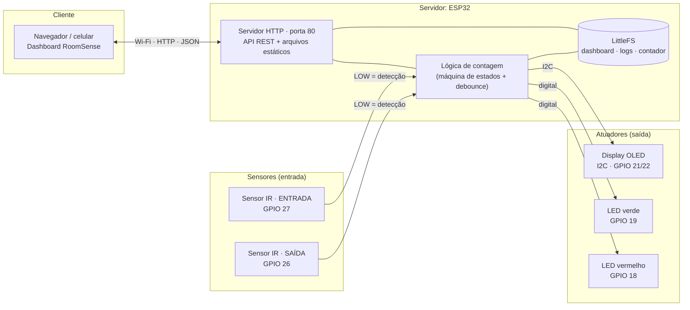
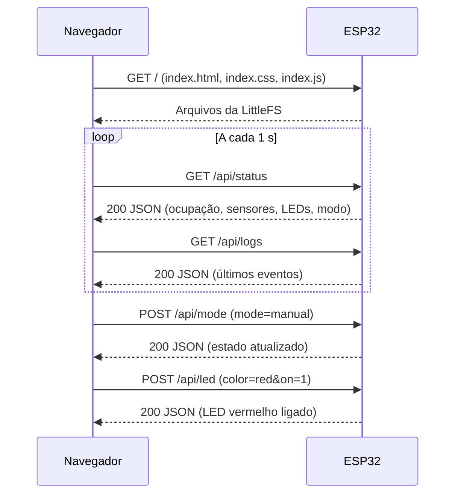
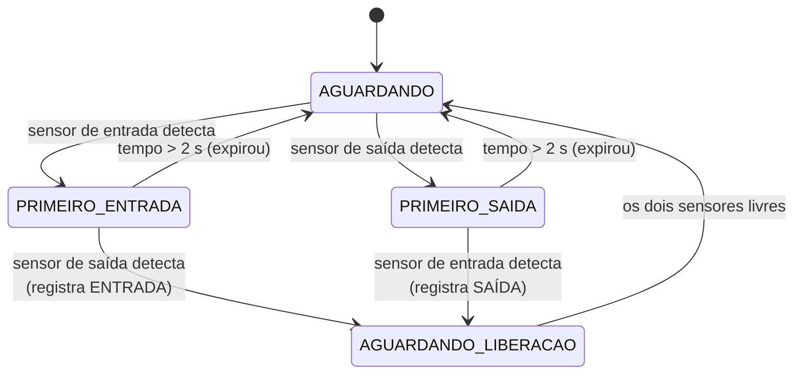

# RoomSense

Sistema de **contagem de pessoas e monitoramento de disponibilidade de salas**, com um **ESP32 atuando como servidor HTTP**. Dois sensores infravermelhos na porta identificam entradas e saídas; o ESP32 mantém a ocupação, sinaliza o estado em LEDs e em um display OLED, e hospeda um **dashboard web** que consulta e comanda o sistema pela rede Wi-Fi local.

> Projeto acadêmico da disciplina **Conectividade em Sistemas Ciberfísicos**, PUCPR, Engenharia de Software (TDE).

## Sumário

1. [Problema resolvido](#1-problema-resolvido)
2. [Integrantes da equipe](#2-integrantes-da-equipe)
3. [Arquitetura da solução](#3-arquitetura-da-solução)
4. [Hardware utilizado](#4-hardware-utilizado)
5. [Como o sistema funciona](#5-como-o-sistema-funciona)
6. [Documentação da API](#6-documentação-da-api)
7. [Dashboard web](#7-dashboard-web)
8. [Instruções de instalação e execução](#8-instruções-de-instalação-e-execução)
9. [Testes](#9-testes)
10. [Vídeo demonstrativo e screenshots](#10-vídeo-demonstrativo-e-screenshots)
11. [Limitações conhecidas](#11-limitações-conhecidas)
12. [Estrutura do repositório](#12-estrutura-do-repositório)

---

## 1. Problema resolvido

Em salas de estudo, laboratórios e salas de reunião, é comum chegar até a porta e descobrir que o ambiente está **lotado**, sem que ninguém pudesse saber antes. Sem controle de acesso, a lotação só é percebida na hora, o que gera deslocamentos desnecessários e dificulta respeitar limites de capacidade.

O **RoomSense** resolve isso com um sistema de baixo custo que:

- conta automaticamente quantas pessoas estão na sala (entradas e saídas);
- sinaliza a disponibilidade **na própria porta** (LED verde/vermelho e display OLED);
- expõe a ocupação por **rede**, para que qualquer navegador na mesma rede consulte o estado sem estar no local;
- permite **comandar os LEDs** e reiniciar o contador remotamente pelo dashboard.

### Atendimento aos requisitos do TDE

| Requisito | Como o RoomSense atende |
|---|---|
| ESP32 como **servidor** | `WebServer` na porta 80, escutando requisições HTTP |
| Pelo menos 1 sensor | 2 sensores infravermelhos FC-51 (entrada e saída) |
| Pelo menos 1 atuador | 2 LEDs e 1 display OLED |
| **Consultar dados** via rede | `GET /api/status` e `GET /api/logs` |
| **Enviar comandos** via rede | `POST /api/led`, `/api/mode`, `/api/reset` e `/api/logs/clear` |
| **Visualizar estado** | Dashboard mostra conexão, sensores, ocupação e LEDs |

---

## 2. Integrantes da equipe

| Nome completo | RA |
|---|---|
| Eduardo Araujo Steigleder | _preencher_ |
| Erick Kenzo Tanaka Okumoto | _preencher_ |
| Isabela Vieira Mayer | _preencher_ |
| João Victor Alves Benfica | _preencher_ |
| Rafael Siqueira Furlan | _preencher_ |

---

## 3. Arquitetura da solução

O **ESP32** é o centro do sistema: lê os sensores, controla os atuadores e, ao mesmo tempo, **serve o dashboard e a API** pela rede. O navegador é o cliente.



### Fluxo de dados, passo a passo

1. Uma pessoa passa pela porta e aciona os dois sensores, um depois do outro.
2. O ESP32 aplica *debounce* e, pela **ordem** dos disparos, decide se foi entrada ou saída.
3. A ocupação é atualizada, salva na memória flash e os atuadores reagem (LEDs e OLED).
4. O dashboard consulta `GET /api/status` e `GET /api/logs` a cada **1 segundo**.
5. Comandos do usuário (LEDs, modo, reset) voltam ao ESP32 por requisições `POST`.



---

## 4. Hardware utilizado

### 4.1 Lista de componentes

| Qtd. | Componente | Função |
|---|---|---|
| 1 | ESP32 DevKit | Microcontrolador e servidor HTTP |
| 2 | Sensor infravermelho FC-51 | Detectar a passagem e o sentido |
| 1 | Display OLED 0,96" SSD1306 (I2C, 128×64) | Mostrar ocupação, vagas e status |
| 1 | LED verde | Indica que há vagas |
| 1 | LED vermelho | Indica que a sala está lotada |
| 2 | Resistores (um por LED) | Limitar a corrente (valor típico: 220 Ω a 330 Ω) |
| 1 | Protoboard + jumpers + cabo USB | Montagem, ligação e alimentação |

> O valor exato dos resistores não consta no esquema; ajuste conforme o que foi usado.

### 4.2 Diagrama de conexões (pinagem)


| Componente | Pino do componente | Pino do ESP32 | Observação |
|---|---|---|---|
| Sensor IR (saída) | OUT | **GPIO 26** | `SENSOR_SAIDA` no código |
| Sensor IR (entrada) | OUT | **GPIO 27** | `SENSOR_ENTRADA` no código |
| OLED | SDA | **GPIO 21** | I2C |
| OLED | SCL | **GPIO 22** | I2C |
| LED verde | Anodo (via resistor) | **GPIO 19** | Sala com vagas |
| LED vermelho | Anodo (via resistor) | **GPIO 18** | Sala lotada |
| Sensores IR e OLED | VCC | **3V3** | Alimentação em 3,3 V |
| Todos | GND | **GND** | Terra comum |

> **Posicionamento na porta:** o sensor de **entrada** (GPIO 27) fica do lado de **fora** e o de **saída** (GPIO 26) do lado de **dentro**. Se a contagem sair invertida, troque os sensores de lugar ou inverta as constantes `SENSOR_ENTRADA` e `SENSOR_SAIDA` no código.

---

## 5. Como o sistema funciona

### 5.1 Detecção de sentido

```
          FORA                                  DENTRO
   ┌───────────────┐                     ┌───────────────┐
   │ Sensor ENTRADA│ ──── passagem ────► │  Sensor SAÍDA │
   │   (GPIO 27)   │                     │   (GPIO 26)   │
   └───────────────┘                     └───────────────┘

   ENTRADA → SAÍDA  =  alguém ENTROU   (ocupação + 1)
   SAÍDA → ENTRADA  =  alguém SAIU     (ocupação − 1)
```

Os dois sensores precisam disparar dentro de uma janela de **2 segundos**.

### 5.2 Máquina de estados



O estado `AGUARDANDO_LIBERACAO` impede que a mesma pessoa seja contada duas vezes: uma nova sequência só começa quando **ambos** os sensores voltam ao estado livre.

### 5.3 Filtros e regras

| Regra | Comportamento |
|---|---|
| Debounce | A leitura só é aceita após **60 ms** estável |
| Borda de detecção | Só a transição para LOW conta (FC-51: LOW = obstáculo) |
| Detecção simultânea | Os dois sensores na mesma leitura → sem ordem confiável, sequência ignorada |
| Sequência expirada | Segundo sensor não disparou em 2 s → movimento não contabilizado (log `warning`) |
| Entrada com 10/10 | Não incrementa; gera log `warning` |
| Saída com 0/10 | Não decrementa; gera log `warning` |
| Movimentação "parado" | Após 1,8 s sem novos eventos, o fluxo volta a `parado` |

### 5.4 Indicadores

**Modo automático** (padrão):

| Condição | LED verde | LED vermelho | OLED |
|---|---|---|---|
| `ocupacao == 0` | Aceso | Apagado | `STATUS: VAZIO` |
| `0 < ocupacao < 10` | Aceso | Apagado | `STATUS: OCUPADO` |
| `ocupacao >= 10` | Apagado | Aceso | `STATUS: LOTADO` |

No **modo manual**, os LEDs deixam de seguir a ocupação e passam a obedecer aos comandos do dashboard.

```
┌──────────────────────┐
│ ROOMSENSE - AMBIENTE │
│ ──────────────────── │
│ Pessoas: 10          │  ← ocupação atual
│ Vagas: 0             │
│ STATUS: LOTADO       │
└──────────────────────┘
```

### 5.5 Persistência

O ESP32 grava na flash (LittleFS) e recupera ao reiniciar:

| Arquivo | Conteúdo |
|---|---|
| `/state.txt` | Ocupação atual, total de entradas e total de saídas |
| `/logs.txt` | Últimos 30 eventos do sistema |

Se o estado salvo for inválido (ocupação negativa ou acima da capacidade), o contador inicia em zero.

### 5.6 Wi-Fi

O ESP32 opera em modo **estação** (`WIFI_STA`): entra em uma rede existente, não cria ponto de acesso. Se a conexão cair, o firmware tenta reconectar a cada 10 segundos. Se o Wi-Fi não estiver disponível no boot, o servidor HTTP sobe assim que a conexão for estabelecida.

### 5.7 Parâmetros do firmware (`RoomSense_ESP32.ino`)

| Constante | Valor | Descrição |
|---|---|---|
| `CAPACIDADE_MAXIMA` | `10` | Máximo de pessoas |
| `TEMPO_SEQUENCIA` | `2000` ms | Janela entre o 1º e o 2º sensor |
| `TEMPO_DEBOUNCE` | `60` ms | Estabilidade exigida na leitura |
| `INTERVALO_OLED` | `250` ms | Atualização do display |
| `INTERVALO_RECONEXAO_WIFI` | `10000` ms | Intervalo entre tentativas de reconexão |
| `MAX_LOGS` | `30` | Eventos mantidos em memória e na flash |
| `OLED_ADDRESS` | `0x3C` | Endereço I2C do display |

A temporização do laço principal é feita com `millis()`; o único `delay()` longo está na conexão inicial ao Wi-Fi (até 20 s no boot).

---

## 6. Documentação da API

O ESP32 atua como **servidor HTTP** na porta **80**, na rede Wi-Fi local.

**URL base:** `http://<IP_DO_ESP32>` (o IP é exibido no Monitor Serial ao conectar ao Wi-Fi)

| Método | Rota | Descrição |
|---|---|---|
| `GET` | `/` | Dashboard (`index.html`, servido pela LittleFS) |
| `GET` | `/api/status` | Estado atual da sala, sensores e LEDs |
| `GET` | `/api/logs` | Histórico de eventos (mais recente primeiro) |
| `POST` | `/api/led` | Liga/desliga um LED (**somente no modo manual**) |
| `POST` | `/api/mode` | Alterna entre modo `auto` e `manual` |
| `POST` | `/api/reset` | Zera o contador de ocupação, entradas e saídas |
| `POST` | `/api/logs/clear` | Apaga o histórico de logs |

Os comandos `POST` usam `application/x-www-form-urlencoded`. Todas as respostas da API são JSON (`application/json; charset=utf-8`) com `Cache-Control: no-store`.

### `GET /api/status`

**Resposta `200 OK`**

```json
{
  "occupancy": 3,
  "capacity": 10,
  "entries": 12,
  "exits": 9,
  "entryDetected": false,
  "exitDetected": false,
  "ledRed": false,
  "ledGreen": true,
  "mode": "auto",
  "movement": "parado"
}
```

| Campo | Tipo | Descrição |
|---|---|---|
| `occupancy` | inteiro | Pessoas atualmente na sala |
| `capacity` | inteiro | Capacidade máxima (`CAPACIDADE_MAXIMA`) |
| `entries` | inteiro | Total de entradas contabilizadas |
| `exits` | inteiro | Total de saídas contabilizadas |
| `entryDetected` | booleano | `true` enquanto o sensor de entrada está detectando |
| `exitDetected` | booleano | `true` enquanto o sensor de saída está detectando |
| `ledRed` | booleano | Estado do LED vermelho |
| `ledGreen` | booleano | Estado do LED verde |
| `mode` | texto | `"auto"` ou `"manual"` |
| `movement` | texto | `"entrando"`, `"saindo"` ou `"parado"` |

### `GET /api/logs`

**Resposta `200 OK`**

```json
{
  "logs": [
    { "time": "00:12:41", "level": "success", "message": "Entrada registrada. Ocupacao: 3/10." },
    { "time": "00:12:40", "level": "info", "message": "Sensor de entrada detectou movimento; aguardando segundo sensor." }
  ]
}
```

| Campo | Descrição |
|---|---|
| `time` | Tempo desde que o ESP32 ligou (`HH:MM:SS`), não é horário real |
| `level` | `info`, `success` ou `warning` |
| `message` | Texto do evento |

### `POST /api/mode`

| Parâmetro | Valores | Descrição |
|---|---|---|
| `mode` | `auto` \| `manual` | Define quem controla os LEDs |

```bash
curl -X POST -d "mode=manual" http://<IP_DO_ESP32>/api/mode
```

Resposta `200` com o mesmo JSON de `/api/status`. Valor inválido → `400`.

### `POST /api/led`

| Parâmetro | Valores | Descrição |
|---|---|---|
| `color` | `red` \| `green` | LED a controlar |
| `on` | `1` \| `0` (também aceita `true` / `on`) | Ligar ou desligar |

```bash
curl -X POST -d "color=red&on=1" http://<IP_DO_ESP32>/api/led
```

| Código | Quando |
|---|---|
| `200` | Comando aplicado; corpo traz o estado atualizado |
| `409` | O sistema está em modo automático: `{"error":"Ative o modo manual antes de controlar os LEDs."}` |
| `400` | Cor inválida: `{"error":"Cor invalida. Use red ou green."}` |

### `POST /api/reset`

Zera ocupação, entradas e saídas, cancela qualquer sequência em andamento e **volta ao modo automático**.

```bash
curl -X POST http://<IP_DO_ESP32>/api/reset
```

### `POST /api/logs/clear`

Apaga o histórico em memória e o arquivo `/logs.txt`.

```bash
curl -X POST http://<IP_DO_ESP32>/api/logs/clear
# {"ok":true,"message":"Historico apagado."}
```

### Arquivos estáticos

Qualquer outra rota é procurada na LittleFS (`/index.css`, `/index.js`, ...). Se o arquivo não existir, a resposta é `404 Arquivo nao encontrado`.

### Comunicação serial (depuração)

O ESP32 espelha os eventos na serial a **115200 baud**, no formato `[HH:MM:SS] nivel: mensagem`.

| Mensagem | Quando aparece |
|---|---|
| `Conectado ao Wi-Fi. IP: ...` | Conexão estabelecida |
| `Servidor HTTP iniciado na porta 80.` | Rotas registradas |
| `Sensor de entrada/saida detectou movimento; aguardando segundo sensor.` | Início de uma sequência |
| `Entrada registrada. Ocupacao: N/10.` | Contagem incrementada |
| `Saida registrada. Ocupacao: N/10.` | Contagem decrementada |
| `Entrada detectada, mas a capacidade maxima ja foi atingida.` | Entrada com 10/10 |
| `Saida detectada, mas o ambiente ja esta vazio.` | Saída com 0/10 |
| `Sequencia de passagem expirou; movimento nao contabilizado.` | Segundo sensor não disparou em 2 s |
| `Falha ao montar LittleFS. Dados persistentes indisponiveis.` | Sistema de arquivos não gravado (veja [8.4](#84-gravar-o-dashboard-littlefs)) |
| `OLED nao encontrado; sistema continuara sem display.` | Falha ao iniciar o display |

---

## 7. Dashboard web

O dashboard é **servido pelo próprio ESP32** (arquivos na LittleFS) e usa caminhos relativos para a API, portanto **precisa ser aberto pelo IP do ESP32**: `http://<IP_DO_ESP32>`.

| Área | O que mostra / faz |
|---|---|
| Indicador de conexão | "ESP32 conectado" ou "desconectado", conforme as respostas do polling |
| Resumo do ambiente | Pessoas, barra de capacidade, vagas, situação (Vazio / Ocupado / Lotado), entradas e saídas |
| Sensores infravermelhos | Estado em tempo real dos sensores de entrada e saída (Livre / Detectando) |
| Fluxo de passagem | Sentido da última movimentação (entrando / saindo) |
| Atuadores | Estado dos LEDs, interruptores (modo manual) e alternância Automático / Manual |
| Eventos dos sensores | Botão para zerar o contador; as entradas e saídas vêm apenas dos sensores físicos |
| Log do sistema | Histórico recebido do firmware e botão **Limpar logs** |

### Mapeamento API → interface

| Campo da API | Elemento da página |
|---|---|
| `occupancy`, `capacity` | Contagem, percentual, barra de progresso e vagas |
| `entries`, `exits` | Contadores de entradas e saídas |
| `entryDetected`, `exitDetected` | Indicadores dos sensores |
| `movement` | Cartão de movimentação e painel de fluxo |
| `ledRed`, `ledGreen`, `mode` | Interruptores, prévia dos LEDs e botões de modo |
| `/api/logs` | Terminal de logs |

---

## 8. Instruções de instalação e execução

### 8.1 Pré-requisitos

- Arduino IDE 2.x
- Suporte a placas ESP32 (Gerenciador de Placas → **esp32** da Espressif)
- Bibliotecas (Gerenciador de Bibliotecas): **Adafruit GFX Library** e **Adafruit SSD1306**
- `WiFi`, `WebServer` e `LittleFS` já fazem parte do pacote ESP32 Arduino
- Plugin para gravar a LittleFS na Arduino IDE 2.x: **arduino-littlefs-upload**
- Rede Wi-Fi **2,4 GHz** acessível ao ESP32 e ao dispositivo cliente

### 8.2 Montagem do hardware

1. Monte o circuito conforme a [pinagem](#42-diagrama-de-conexões-pinagem).
2. Alimente sensores e OLED pelo **3V3** e una todos os GND.
3. Posicione o sensor de entrada (GPIO 27) por fora e o de saída (GPIO 26) por dentro da porta.
4. Ajuste o potenciômetro de cada FC-51 até o LED do módulo acender somente quando alguém passa.

### 8.3 Configurar e gravar o firmware

1. Abra `RoomSense_ESP32.ino` na Arduino IDE (a pasta do sketch deve ter o mesmo nome do arquivo).
2. Informe a rede nas constantes do início do código:
   ```cpp
   const char* WIFI_SSID = "NOME_DA_REDE";
   const char* WIFI_PASSWORD = "SENHA_DA_REDE";
   ```
   > **Não faça commit da senha real.** Mantenha o valor de exemplo no repositório.
3. Em **Ferramentas**, selecione a placa (*ESP32 Dev Module*) e a porta COM.
4. Clique em **Upload**.

### 8.4 Gravar o dashboard (LittleFS)

O dashboard vive na pasta `data/`, ao lado do `.ino`, e precisa ser gravado na flash separadamente:

```
RoomSense_ESP32/
├── RoomSense_ESP32.ino
└── data/
    ├── index.html
    ├── index.css
    └── index.js
```

1. Feche o Monitor Serial (ele ocupa a porta COM).
2. Na Arduino IDE, abra a paleta de comandos (`Ctrl+Shift+P`) e execute **Upload LittleFS to ESP32**.
3. Sempre que alterar `index.html`, `index.css` ou `index.js`, repita este passo.

> O firmware monta a LittleFS **sem formatar** (`LittleFS.begin(false)`). Se o passo acima nunca foi feito, a montagem falha: o dashboard retorna 404 e logs/contador não são salvos.

### 8.5 Descobrir o IP e abrir o dashboard

1. Abra o **Monitor Serial** (115200 baud).
2. Aguarde a mensagem `IP do RoomSense: http://192.168.x.x`.
3. No computador ou celular, conectado à **mesma rede**, abra esse endereço no navegador.

---

## 9. Testes

### 9.1 Teste rápido (físico)

1. Passe a mão no sensor de **entrada** e depois no de **saída** (em até 2 s) → ocupação sobe.
2. Faça o inverso → ocupação desce.
3. Repita até 10 → LED vermelho acende e o OLED mostra `STATUS: LOTADO`.
4. Tente uma 11ª entrada → a contagem não muda e o log registra um `warning`.

### 9.2 Teste da API (cURL / Postman)

```bash
# Consultar o estado
curl http://<IP_DO_ESP32>/api/status

# LED em modo automático deve ser recusado (409)
curl -i -X POST -d "color=red&on=1" http://<IP_DO_ESP32>/api/led

# Ativar modo manual e acender o LED vermelho
curl -X POST -d "mode=manual" http://<IP_DO_ESP32>/api/mode
curl -X POST -d "color=red&on=1" http://<IP_DO_ESP32>/api/led

# Voltar ao automático e zerar o contador
curl -X POST http://<IP_DO_ESP32>/api/reset
```

### 9.3 Tratamento de falhas

| Situação | Comportamento esperado |
|---|---|
| ESP32 desligado ou fora da rede | Dashboard mostra "ESP32 desconectado" e retoma sozinho quando a comunicação volta |
| Reinício do ESP32 | Ocupação, entradas, saídas e logs são recuperados da flash |
| Wi-Fi cai durante o uso | O firmware tenta reconectar a cada 10 s; os sensores continuam contando |
| OLED não encontrado | O sistema segue funcionando sem display |
| Comando de LED em modo automático | API responde `409` e o dashboard exibe o erro |

---

## 10. Vídeo demonstrativo e screenshots

**Vídeo:** _inserir link do vídeo (YouTube, Drive etc.)_

### Montagem física

Protótipo em protoboard com ESP32, dois sensores FC-51, LEDs verde e vermelho e display OLED. A foto mostra o estado **lotado** (10/10).


### Interface web

_Inserir screenshot do dashboard em funcionamento, por exemplo:_ ``

---

## 11. Limitações conhecidas

- **Uma pessoa por vez:** passagens simultâneas ou muito próximas podem gerar contagem errada.
- **Janela de 2 s:** se alguém parar entre os sensores por mais tempo, a sequência é descartada.
- **Sensibilidade do FC-51:** sofre influência da luz ambiente e da superfície do objeto; exige calibração.
- **Mesma rede local:** não há acesso pela internet, autenticação nem HTTPS; qualquer dispositivo na rede pode chamar os comandos `POST`.
- **Atualização por polling:** o dashboard consulta o ESP32 a cada 1 s, sem WebSocket.
- **Logs com tempo relativo:** os horários dos eventos contam desde o boot do ESP32, pois não há relógio de tempo real.
- **Desgaste da flash:** cada evento regrava os arquivos de log e de contador; em uso prolongado convém reduzir a frequência de gravação.
- **Boot sem Wi-Fi:** durante a tentativa inicial de conexão (até 20 s) os sensores não são lidos.

---

## 12. Estrutura do repositório

```
Projeto-RoomSense/
├── README.md                       # Esta documentação
├── .gitignore
├── docs/
│   ├── esquematico_smartroom.png   # Esquemático do circuito
│   ├── Demonstração_física_projeto.jpeg
│   └── interface_web.png           # Screenshot do dashboard (adicionar)
└── src/
    └── esp32/
        └── RoomSense_ESP32/
            ├── RoomSense_ESP32.ino # Firmware do ESP32 (servidor + sensores + atuadores)
            └── data/               # Cliente web, gravado na LittleFS do ESP32
                ├── index.html
                ├── index.css
                └── index.js
```
